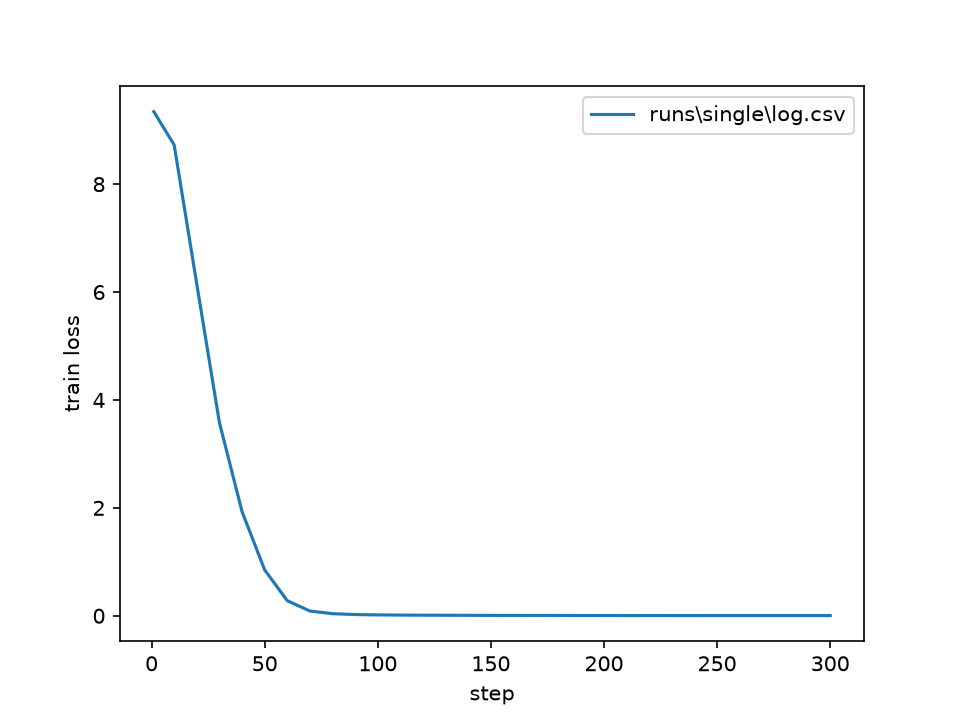
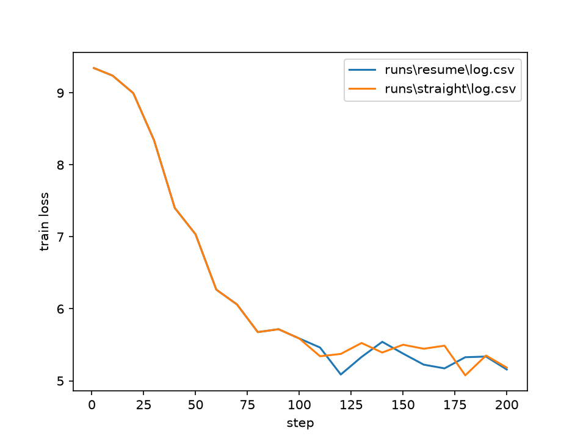
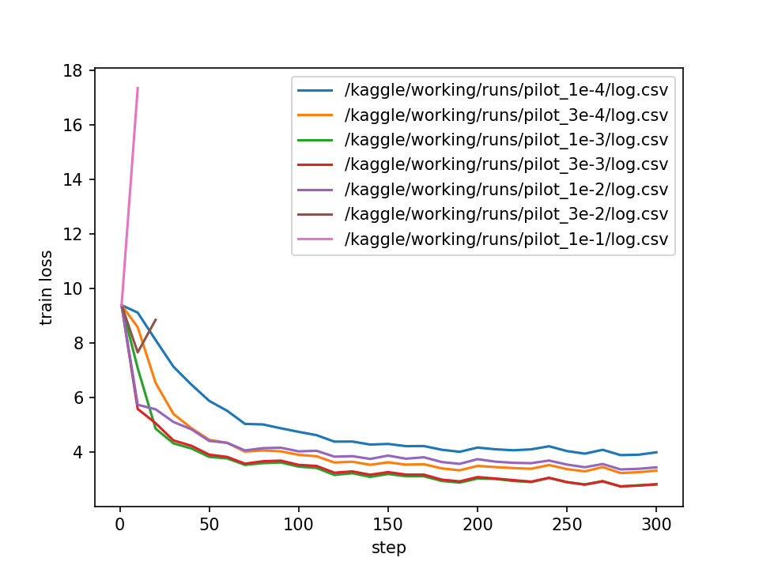
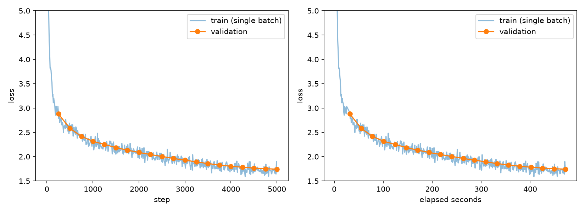

# Building a Small Language Model from Scratch: Writeup


I built a 22.7M-parameter GPT-style model that writes short children's stories: my own BPE tokenizer, my own Transformer, a training script and a command-line generator. After about 8 minutes of training on a free Kaggle T4 it reaches a validation loss of 1.7435 (perplexity 5.72). Every number below is one I measured. Code: github.com/Hardik0710/minilm

## 1. Tokenizer (Parts 1 and 2)

**Warm-up answers.**

- `chr(0)` is the null character. `repr` shows it as `'\x00'`, but `print` outputs an invisible character, so "this is a test" + `chr(0)` + "string" looks like "this is a teststring".
- UTF-8 is the best choice for English: "hello" takes 5 bytes in UTF-8, 12 in UTF-16 and 24 in UTF-32. The longer encodings add a byte-order mark and zero bytes that a tokenizer would waste merges removing. UTF-8 also gives a fixed starting alphabet of 256 bytes, so nothing is ever unknown. It is not always smallest: the Hindi word "नमस्ते" is 18 bytes in UTF-8 and 14 in UTF-16.
- Decoding one byte at a time is wrong because many characters use several bytes, and one byte from a multi-byte character is not valid alone. It crashed on the first byte (`0xe0`) of "नमस्ते".
- `bytes([0xC3, 0x28])` is invalid. `0xC3` starts a two-byte character, so the next byte must look like `10xxxxxx`, but `0x28` is `00101000`.

**Training.** My code gives the expected first six merges on the hand-worked example (low, lower, widest, newest): `s t`, `e st`, `o w`, `l ow`, `w est`, `n e`. The first merge is a tie between (s,t) and (e,s) at 9 each, and the larger-tuple rule picks (s,t). Training 10,000 tokens on the validation file took 36 s. For the real tokenizer I used the first 500 MB of the training file, cut at a story boundary, which took 314 s. The longest token is `b' accomplishment'` (15 bytes). That makes sense: the pattern keeps the leading space with the word, and it is a common word in these stories. I did not record peak memory for the 500 MB run; the only figure I have is 90 MB of Python allocations on the small file.

**Q1 (cProfile).** Merging took most of the time. On the validation file the profiled run took 288 s, but most of that was profiler overhead (the plain run took 36 s). `max()` over the pair counts used about 51 s itself plus 53 s in its key function, called 99.6 million times. Splitting into pre-tokens (regex matching, `.group()`, `.encode()`) took roughly 56 s. This split is approximate, because `train_bpe` is one function and its own 109 s mixes both phases. On the 2 GB file the pre-tokenizing share would grow, since it scales with file size while merging scales with the number of distinct words.

**Encoding.** `Tokenizer` handles special tokens (the longer match wins), round-trips English, Hindi, emoji and the empty string, and gives `[9, 7, 1, 5, 10, 3]` for "the cat ate" in the hand-worked example. Both files are saved as `uint16`: 540,810,517 training tokens and 5,461,342 validation tokens. Compression is 4.12 bytes per token on both files and 4.14 on 10 random validation stories (range 3.83 to 4.81). The validation file encoded at 5.56 MB/s (4 s) and the training file at 3.09 MB/s (720 s). I don't know why the big file was slower; I did not test my guesses (word cache, memory effects).

**Q2 (uint16).** Token IDs go up to 9,999 and `uint16` holds up to 65,535, so each token costs 2 bytes instead of 8 for `int64`. The training array is 1.08 GB instead of about 4.3 GB and can be memory-mapped cheaply. It stops being enough once the vocabulary passes 65,536 tokens; then `uint32` is needed.

## 2. Model pieces (Parts 3 and 4)

My hand-written attention matches PyTorch's `scaled_dot_product_attention` within 1e-5 for 3-D and 4-D inputs, and my RoPE matches a slow version that builds the full rotation matrix. Every piece keeps its input shape, including with extra batch dimensions. The full model returns logits of shape (2, 17, 10000), and a test confirms that changing tokens after position t leaves every output up to t unchanged. The loss on random tokens starts near ln(10,000) = 9.21, because an untrained model spreads its guess almost evenly over 10,000 tokens.

**Q3 (why divide by √d_k).** With d_k = 32, dot products of random vectors had a standard deviation of 5.57 (theory: √32 = 5.66). After dividing it was 0.98. Without the division the softmax became almost one-hot: one example gave 0.63 and 0.36 to two entries and about 1e-4 to 1e-6 to the rest. A saturated softmax passes almost no gradient back, so learning stalls. With the division the weights stayed spread out (0.03 to 0.34).

**Q4 (RoPE only sees the distance).** I put the same query and key at every position. With i − j = 3 the dot product was −3.482756, −3.482755, −3.482755 and −3.482756 at (i, j) = (3, 0), (10, 7), (50, 47) and (100, 97). Other distances gave different values: −2.05 (distance 0), −3.04 (1), −1.44 (5) and −1.51 (20). RoPE turns the query by an angle proportional to i and the key by one proportional to j. Rotations satisfy R(a)ᵀR(b) = R(b−a), so only the difference between the positions is left. The last-digit differences are float32 rounding.

**Q5 (parameters).** The total is 22,696,448, and the count from code agrees.

| Part | Count |
| --- | --- |
| Embedding (10,000 × 512) | 5,120,000 |
| Attention per layer (4 × 512²) | 1,048,576 |
| Feed-forward per layer (3 × 512 × 1344) | 2,064,384 |
| Two norms per layer | 1,024 |
| One layer | 3,113,984 |
| Four layers | 12,455,936 |
| Final norm | 512 |
| Output layer (512 × 10,000) | 5,120,000 |

The embedding and output layers hold 10,240,000 parameters, about 45% of the total.

**Q6 (work for 256 tokens).** A multiply of m×n by n×p costs 2mnp. Per layer:

| Multiply | FLOPs |
| --- | --- |
| Q, K, V and output projections (4 × 2·256·512·512) | 536.9M |
| Scores QKᵀ (16 heads) | 67.1M |
| Weights × V | 67.1M |
| Feed-forward (3 matrices) | 1,057.0M |
| One layer | 1,728.1M |

Four layers cost 6.91G and the output layer 2.62G, so one forward pass is about 9.53 GFLOPs. The feed-forward layers do the most work (44%), then the output layer (27.5%), the projections (22.5%) and the attention scores (5.6%).

**Q7 (GPT-2 small).** With 12 layers, d = 768, 12 heads, 50,257 tokens, context 1,024 and a two-matrix feed-forward with d_ff = 3072, one layer costs 17.72G (projections 4.83G, attention 3.22G, feed-forward 9.66G). Twelve layers cost 212.6G and the output layer 79.05G, about 291.6G in total. Inside a layer the attention-score share rises from 7.8% to 18.2%, because it grows with the square of the context length, and the feed-forward share falls from 61% to 54.5%. I expected the output layer's share to shrink, but it barely moved (27.5% to 27.1%): the vocabulary grew about 5 times while the layers grew a lot too.

## 3. Training setup and checks (Parts 5 and 6)

**Learning-rate warm-up.** For `mean(w²)` over 100 values the gradient is 0.02·w, so each SGD step multiplies the weights by (1 − 0.02·lr). Over 10 steps the loss went 26.3 → 18.3 (lr 1, slow), 26.3 → 0.47 (lr 10, fast), stayed at 26.3 (lr 100, the weights just flip sign) and reached 2.7e24 (lr 1000, factor −19 per step).

**Q8 (memory in fp32).** Parameters take 22,696,448 × 4 bytes = 90.8 MB, gradients another 90.8 MB, and AdamW's state 181.6 MB, about 363 MB before activations. AdamW keeps two extra numbers per weight, a running average of the gradient and a running average of its square, so its state is twice the size of the weights.

**Tests and speed.** 38 tests pass (1 skipped) on my laptop and 39 pass on the Kaggle T4, where the GPU-only test (fp16 loss close to fp32) runs. `torch.compile` made a training step 1.24x faster (107 ms to 86 ms), measured after fixing the data problem described in section 6.

**Single-batch check.** On a tiny 1.36M-parameter model the loss fell from 9.34 to 0.0032, and the gradient norm peaked at 1.01 and decayed to 0.002. Validation loss rose from 7.35 to 10.39 because the model memorised that one batch, which also shows validation data is separate from training data.



**Resume check.** I stopped a run at step 100 and resumed it. The learning rate continued on the same curve (5.16e-4 at step 110, 1.00e-4 at step 200) with no jump. Validation loss at step 200 was 5.2694 resumed against 5.2695 uninterrupted. Training loss differs a little step to step because batches are drawn differently after resuming; the exact-match check is a unit test.



**Gradient norm.** Over the first 100 steps it stayed between 0.47 and 0.93, with no NaN and no growth.

**Learning-rate pilots.** Each pilot ran 300 steps in fp16 with a 5% warm-up. I tried a spread of rates from 1e-4 to 1e-2, and since none broke training I went higher (3e-2, 1e-1) until one did.

| Learning rate | Final validation loss |
| --- | --- |
| 1e-4 | 3.9985 |
| 3e-4 | 3.3399 |
| 1e-3 | 2.8493 |
| 3e-3 (best) | 2.8284 |
| 1e-2 | 3.4414 |
| 3e-2 | blew up before step 30 |
| 1e-1 | blew up before step 20 |



**Q9 (the rate that blew up vs the best).** The best rate, 3e-3, is ten times below the first rate that broke (3e-2). At 1e-1 the loss was already 17.35 at step 10, worse than a random guess, with a gradient norm of 18.3. Clipping at 1.0 did not save these runs, because AdamW's step size depends on the learning rate, not on how big the gradient is. So "the best rate sits just below the point where training breaks" is only loosely true here: 1e-2 was stable but clearly worse, so it sits in between. Also, 3e-3 and 1e-3 differ by only 0.02, about the noise level, and 3e-3 had a gradient-norm spike of 3.15 at the end of warm-up. I do not know whether the blow-ups were fp16 overflow or real divergence, because I did not rerun them in fp32.

## 4. Main run and stories (Part 7)

I trained with lr 3e-3 for 5,000 steps at batch size 32 and context 256, which is 40,960,000 tokens (about 7.6% of the training data, so no text was repeated). The learning rate warmed up for 250 steps, then decayed to 3e-4, reaching exactly that value at the last step. Training took 472 s (7.9 min) on a Kaggle T4.

**Final validation loss: 1.7435. Perplexity: e^1.7435 = 5.72.** That is below the 2.0 target. The final training loss was about 1.7, so the model is not overfitting, and the gradient norm stayed near 0.3 with no spikes. Validation uses 20 fixed batches (about 164,000 tokens), so it is a somewhat noisy estimate of the full validation loss.



**Stories.** Left alone, the model ends stories at about 125 to 185 tokens by writing the end-of-text token. To get 256 tokens or more I blocked that token until 256 new tokens existed. The full text of three stories is in `stories.txt`. The prompt was "Once upon a time" each time.

- Temperature 0.7, top-p 0.9, seed 1 (268 tokens): "...there was a little girl named Lily. She loved to play with her toys and run around the house. One day, she saw a big, shiny rock in her room..." It ends with a repeated lesson about being careful.
- Temperature 0.7, top-p 0.9, seed 2 (262 tokens): a girl named Amy finds a shiny rock, but the plot slips: "She put the rock on the rock and turned it on."
- Temperature 1.0, top-p 0.95, seed 1 (262 tokens): starts well, then repeats "The moral of the story is..." and ends in broken fragments.

**Q10 (how fluent are they).** At the sentence level they read well: the grammar is right, character names stay consistent and dialogue punctuation is correct. Two things clearly change the quality.

1. Temperature and top-p. At 0.7 the text is safe but repetitive (the "play with it" and "be careful" loops). At 1.0 unlikely words get through. A different 1.0 run (seed 2) produced "the 'fet triangle!'" and "had chose to pay attention to the attic".
2. Story length against what the model can hold. Past its natural ending, forced text drifts into repeated morals and logic slips like "the rock could talk". I put this down to the small model (22.7M parameters) and short training (41M tokens), not a code bug, but I have not tested that with a bigger model.

## 5. Packaging (Part 8)

`release/` holds `model.pt` (weights only, about 87 MB), `config.json`, `vocab.json` and `merges.txt`. The README command is:

```
python inference.py --model-dir release --prompt "Once upon a time" --max-new-tokens 256 --temperature 0.8 --top-p 0.9 --seed 42 --device cpu
```

The same seed gives the same story: two runs matched word for word. I also cloned the repo into a new folder, made a new virtual environment, installed only `requirements.txt` and ran the command. It worked and printed the same story.

**Q11 (CPU speed and the repeated work).** I measured 43.3 and 50.4 tokens per second in two runs, generating 184 tokens in 4.3 s and 3.7 s. The machine is an Intel Core 5 210H (8 cores) with 16 GB RAM on Windows, running fp32 on the CPU. I treat the 15% gap between runs as ordinary CPU noise. The story stopped at 184 tokens because the model wrote the end-of-text token before reaching 256.

The rest of this answer is an estimate, because I did not build or time a cache. Without one, every new token runs the whole model over all earlier tokens again. With a 4-token prompt and 184 new tokens that is about 4 + 5 + ... + 188, roughly 17,700 token positions, against 188 if each were processed once. So about 99% of that work is repeated. A cache would cut the projections, feed-forward and output layers to one token per step. The attention scores would still look back over every earlier token, so that part saves less. I would expect a total saving of several times, but I have not measured it. Once the text passes the 256-token window, a simple cache would also need extra care, because the window slides.

## 6. Bugs versus limits

**Mistakes I found and fixed**

- `pytest` could not import `minilm`, because the project root was not on the import path. I fixed it with a `conftest.py`.
- I first saved `merges.txt` as text split on a space, which is ambiguous because a token can contain a space byte. I switched the vocabulary and merges files to hex.
- My first `.gitignore` was empty, so git listed the 2 GB data folder. I fixed it before the first commit. I also found `runs/` had been committed by mistake and removed it from git.
- The 288 s BPE timing was mostly profiler overhead. The real time was 36 s.
- On Kaggle each batch took 606 ms because the data file sat on a slow input disk, while the model step took only 111 ms. Copying the data to local disk brought batch loading down to 1 ms. My first `torch.compile` timing (2101 vs 953 ms, "2.21x") was mostly disk effects, so I discarded it and measured again.
- My own time guesses were off (BPE on 500 MB: guessed 15 to 30 min, took 5.2 min). I report only measured values.

**Limits of the setup, not bugs**

- The tokenizer was trained on the first 500 MB of the 2 GB file, and I did not record its peak memory.
- The pilots were only 300 steps, so 3e-3 against 1e-3 may come out differently over 5,000 steps.
- I did not separate fp16 overflow from real divergence at the two highest rates.
- Stories needed the end-of-text token blocked to reach 256 tokens.
